<div align="center">

# MPS-FOC STM32G431

### 开源无刷电机 FOC 控制工程 · 硬件版本 V1.3

<p>
  
  
  
  
  
</p>

</div>

## 目录

- [1. 项目概况](#sec-1)
- [2. MPS 大学计划与器件申领](#sec-2)
- [3. 板级接口](#sec-3)
- [4. 软件结构](#sec-4)
- [5. 控制接口](#sec-5)
- [6. 控制链路实现](#sec-6)
- [7. 测试](#sec-7)
- [8. 上电调试](#sec-8)
- [9. 新电机适配](#sec-9)
- [10. 已知限制](#sec-10)
- [11. 许可证说明](#sec-11)

---

<a id="sec-1"></a>

## 1. 项目概况

固件以 `STM32G431CBT6` 为主控，驱动三相 PMSM/BLDC 关节电机，采用 `id = 0` 的转子磁场定向控制。控制链路覆盖三相电流采样、编码器角度观测、电流/速度/位置三环、功率级保护与上位机遥测，并配套板级 bring-up 流程和验收测试数据。

默认参数针对 `GIM6010-48` 级别关节电机：14 极对、8:1 减速、编码器装在转子侧、方向符号 `-1`。额定参数见 [`docs/GIM6010-48电机参数表.xlsx`](docs/GIM6010-48电机参数表.xlsx)，`GIM6010-8` 的三种电压配置见 [`docs/GIM6010-8关节电机参数表.docx`](docs/GIM6010-8关节电机参数表.docx)。代码中的 `Kt` 取转子侧等效值 `0.60 N·m/A`，由输出轴扭矩常数 `4.7 / 8` 推算，与转速常数互验。

### 1.1 仓库结构

```text
.
├── README.md
├── LICENSE
├── 3dmodel/                 # 3D 模型：整机、力臂、对拖平台
├── circurit/                # V1.3 硬件设计文件：EDA 工程、Gerber、网表
├── datasheet/               # 器件手册
├── docs/                    # 上电调试说明、电机参数表、新电机适配流程
├── figure/                  # README 配图：实物、平台、测试曲线、热像
├── host_app/                # Windows 串口上位机：带宽调参、实时波形、模式控制
├── program/
│   ├── STM32G431_FOC.ioc    # CubeMX 工程
│   ├── Core/                # HAL 初始化、中断、外设配置
│   ├── App/                 # 控制算法与应用逻辑
│   ├── Drivers/             # CMSIS 与 STM32G4 HAL
│   └── MDK-ARM/             # Keil 工程
└── video/                   # 视频脚本与图形素材
```

硬件设计同步发布于嘉立创开源广场：[STM32G431-MPS-COMPETITION-FOC](https://oshwhub.com/banzang/project_bpnjkxhi)。`software/` 目录本地保留 MA600A 厂商 MagAlpha 评估软件安装包，未纳入版本管理。

### 1.2 硬件组成

- `STM32G431CBT6` — 主控，170 MHz，带高级定时器
- `MA600A` — 16 bit 绝对值磁编码器，位置反馈
- `MP6539B` — 三相半桥预驱，驱动功率级
- `MP4583` — 宽输入 DCDC，48 V 母线供电
- `MIE1W0505` — 栅极驱动隔离供电
- `MPM3632S` — 3.3 V POL，为 MCU 与编码器供电
- `MP20051` — 待机与辅助电路供电

其余器件手册见 [`datasheet/`](datasheet)，包含 `BSC030N08NS5`（功率 MOSFET）、`INA240`（电流检测放大器）、`MA600`/`MA600A` 等。

<p align="center">
  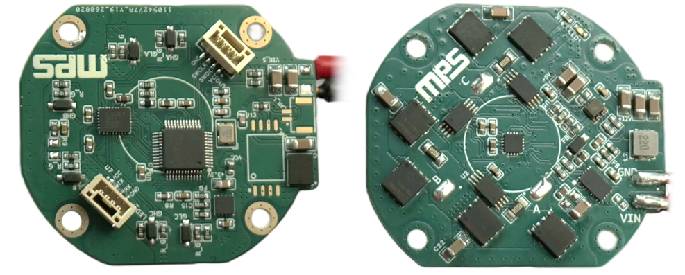
  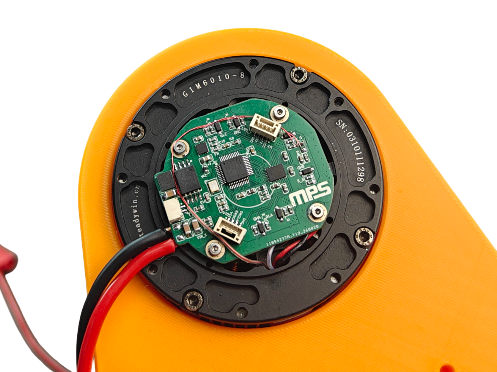
</p>

---

<a id="sec-2"></a>

## 2. MPS 大学计划与器件申领

本项目源自 2025 MPS“智驱未来”机器人芯动力设计挑战赛，赛事说明见 [2025 MPS“智驱未来”机器人芯动力设计挑战赛](https://docs.qq.com/doc/DY1BZckttV2ZQaEhj)。

<p align="center">
  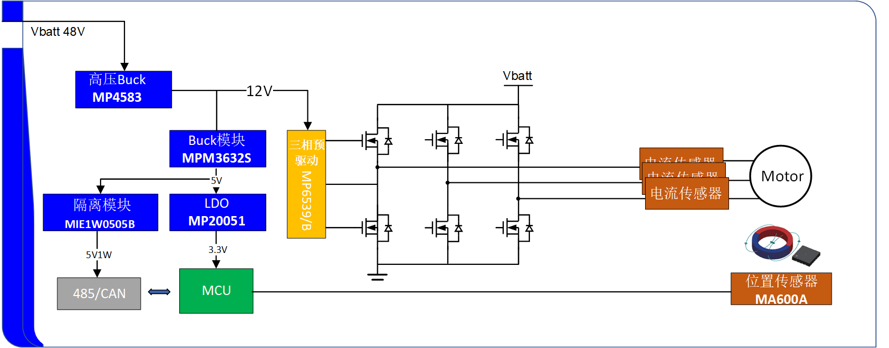
</p>

工程复刻所需的同款芯片可通过 MPS 样品申领入口免费获取：<https://app-u.jingsocial.com/surl/JNH9Kul>

<p align="center">
  
  
</p>

---

<a id="sec-3"></a>

## 3. 板级接口

### 3.1 功率接口

电源与 UVW 三相出线端位于板边。若上电后电机无法正常运转，优先核对编码器正方向与三相相序是否一致：可将 `CFG_ENC_DIR_SIGN` 取反，或对调任意两根相线。

<p align="center">
  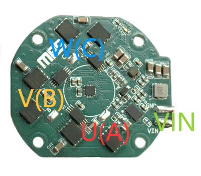
</p>

引脚分配看 V1.3 原理图，外设配置以 CubeMX 工程 [`program/STM32G431_FOC.ioc`](program/STM32G431_FOC.ioc) 为准。软件里只用两个极性别弄反：`N_SLEEP`（`PB14`）高电平使能功率级，`N_FAULT`（`PB15`）低有效。

板载通讯接口按丝印连接。

<p align="center">
  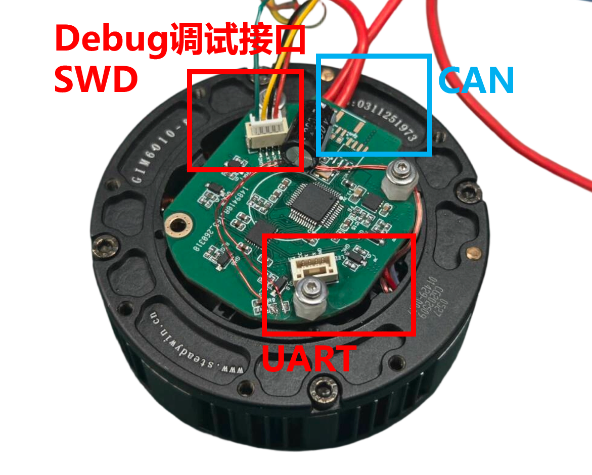
</p>

### 3.2 通信外设

- `SPI1` — 主机、16 bit、`CPOL=1`、`CPHA=2EDGE`、软 NSS、分频 8，专用 `MA600A` 角度读取
- `USART1` — `115200 8N1`、TX DMA、RX 中断。上电默认输出 5 路 VOFA JustFloat；连接本项目上位机后切换到带 CRC、回执和状态回读的 FOC Serial v4 协议
- `FDCAN1` — 保留 CubeMX 默认初始化参数
- `TIM6 + ADC2 DMA` — `1 kHz`，触发母线电压/NTC 采样并驱动 1 ms 系统节拍

---

<a id="sec-4"></a>

## 4. 软件结构

### 4.1 模块划分

<p align="center">
  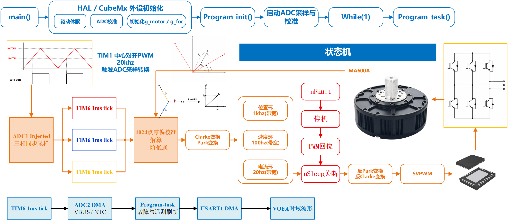
</p>

`program/Core/` 是 HAL 初始化、中断向量与 CubeMX 外设配置，业务代码全在 `program/App/`：

| 文件 | 职责 |
| --- | --- |
| `motor_ctrl.c` | 控制核心：状态机、保护、对齐、观测器、三环、模式分发 |
| `foc_core.c` | Clarke / Park / 反 Park / SVPWM，缓存 `sin/cos` |
| `board.c` | 板级抽象：ADC 换算、NTC、GPIO、TIM1 占空比、DWT 计时 |
| `ma600a.c` | MA600A SPI 驱动：非阻塞读角、跳变剔除、通讯错误统计 |
| `host_link.c` | 上位机协议、参数校验、带宽到 PI 换算、远程运行超时停机 |
| `cli_uart.c` | UART DMA 发送与接收环形缓冲 |
| `motor.h` · `app_config.h` | 对外接口 `g_cmd` / `g_fb` 与模式故障枚举；全部参数的唯一出处 |
| `units.h` · `filter.c` · `program.c` | 角度包绕与坐标系变换、一阶低通、胶水层（初始化与后台遥测） |

### 4.2 执行频率

全部控制、保护与慢速采样都在 `ADC1` 注入组完成中断这一个上下文内执行，慢任务按 `CFG_SLOW_DIV` 分频，`g_fb` 的读写不存在跨上下文竞态。

- PWM 载波 — 约 `20 kHz`，`TIM1` 中心对齐，`ARR=4249`，`RCR=3`
- 快环（电流环）— `10 kHz`，`ADC1` 注入组完成中断，`T1_TRGO2` 触发
- 速度环 — 名义 `2 kHz`，每 `CFG_SPD_WINDOW_SAMPLES = 5` 个快环样本产生一次速度估计
- 位置环 — `200 Hz`，快环内按 `CFG_POS_DT_S` 分频
- 慢任务 — `1 kHz`，快环内 `CFG_SLOW_DIV = 10` 分频：母线/NTC 换算、过压欠压锁存、派生单位
- 母线/NTC 采样 — `1 kHz`，`TIM6 TRGO → ADC2 + DMA`
- 后台遥测 — 约 `333 Hz`（3 ms），`while(1)` 中的 `program_task()`；VOFA JustFloat 共 5 路：两轴实际电流、输出轴转速、输出轴位置、编码器机械角，详见 [`docs/program-debug.md`](docs/program-debug.md#4-新-vofa-通道表)

---

<a id="sec-5"></a>

## 5. 控制接口

对外接口只有两个全局结构体，定义在 [`program/App/motor.h`](program/App/motor.h)：

```c
extern volatile motor_cmd_t g_cmd;   /* 用户写：模式、开关、目标值、调参量 */
extern volatile motor_fb_t  g_fb;    /* 用户读：状态、故障、全部测量量 */
```

### 5.1 命令接口 `g_cmd`

完整字段定义见 `motor.h`，操作顺序固定为**先设 `mode` 和目标值，最后置 `run = 1`**。常用项是 `mode`、`run`、`iq_lim_a`（同时限制电流给定和速度环输出）、三个模式目标 `iq_a` / `spd_rpm` / `pos_deg`，以及三环参数 `cur_kp` `cur_ki`、`spd_kp` `spd_ki`、`pos_kp` `pos_ki` `pos_kd` 和 `spd_lpf_hz`、`pos_spd_lim_rad_s`。

电压模式的 `ud_v` / `uq_v`、`PWM_TEST` 的占空比、`clear_fault` 等操作项见 [`docs/quick-start.md`](docs/quick-start.md)。

### 5.2 运行模式

- `MOTOR_MODE_DISABLED` — 功率级关闭，PWM 保持 50%，安全态
- `MOTOR_MODE_PWM_TEST` — 固定占空比发波，验证 `TIM1 + MP6539B`
- `MOTOR_MODE_VOLTAGE` — d/q 轴电压直接给定，角度来源由 `volt_open_angle_en` 决定
- `MOTOR_MODE_CURRENT` — 电流环，d/q 轴电流直接给定
- `MOTOR_MODE_SPEED` — 速度环，给定转子侧转速
- `MOTOR_MODE_POSITION` — 位置环，给定输出轴角度

后三种模式需要编码器并执行零位对齐。运行中可直接修改 `mode`，环路状态自动复位，闭环类模式之间切换保留对齐结果；每次 `run = 1` 启动闭环类模式都会重新对齐。

### 5.3 反馈接口 `g_fb`

字段按状态、电流、角度与位置、速度、电压与温度、占空比与实时性、编码器统计七组组织，命名与 `motor.h` 一致。上位机右侧「实时数据」栏和 5 路 VOFA 波形取的就是其中常用项。

`fault_bits` 的位定义：

| 位                       | 掩码     | 含义    |
| ----------------------- | ------ | ----- |
| `FAULT_BIT_DRIVER`      | `0x01` | 驱动故障  |
| `FAULT_BIT_OVERCURRENT` | `0x02` | 过流    |
| `FAULT_BIT_OVERVOLT`    | `0x04` | 过压    |
| `FAULT_BIT_UNDERVOLT`   | `0x08` | 欠压    |
| `FAULT_BIT_ENCODER`     | `0x10` | 编码器失效 |

前两项与编码器位在快环 `10 kHz` 判定，母线两项在慢任务 `1 kHz` 锁存。任一位置位即进 FAULT 并关断功率级；置 `g_cmd.clear_fault = 1` 会同时清 `run`，仅当 `N_FAULT` 已释放时才清掉掩码回到 IDLE，否则保持锁存。

---

<a id="sec-6"></a>

## 6. 控制链路实现

### 6.1 从电流采样到 PWM 更新

`TIM1` 以中心对齐方式输出六路互补 PWM，并通过 `TRGO2 = UPDATE` 触发 `ADC1` 注入组。每拍快环的执行流程：

```text
Algorithm 1  快环（ADC1 注入组完成中断，10 kHz）
 1: 登记三相电流原始码值；零偏未完成时继续累计样本
 2: 发起下次编码器 SPI 读角，消费已完成样本，更新机械角、连续角与测速窗
 3: 计算本拍电角度（快环唯一计算点），写入 sin/cos 缓存
 4: 扣零偏并换算为安培，Clarke / Park 得到 id、iq
 5: if 慢任务分频到点 then
 6:     母线 / NTC 换算，过压欠压锁存
 7: end if
 8: 汇聚快环与慢任务故障位
 9: if 故障位置位 then state ← FAULT，关闭功率级
10: if g_cmd.clear_fault then 清故障，state ← IDLE
11: 按 state 分支：IDLE / ALIGN / RUN / FAULT；RUN 内按 mode 分发到三环
12: 反 Park → SVPWM → 写入 TIM1->CCR1/2/3，回写 g_fb 状态镜像
13: 用 DWT 统计本次耗时 loop_us，超时累加 overrun_cnt
```

其中 Clarke 与 Park 变换在三个坐标系之间依次转换：

| 三相静止坐标系 abc                   | 两相静止坐标系 αβ                   | 两相旋转坐标系 dq                   |
| ----------------------------- | ---------------------------- | ---------------------------- |
|  |  |  |
| 三相电流                          | Clarke 变换后                   | Park 变换后                     |

### 6.2 电流采样与零偏校准

三相电流经分流电阻和固定增益放大后送入 `ADC1` 注入组，由 `TIM1 TRGO2` 触发，与 PWM 同步采样。上电后累计 `CFG_OFFSET_SAMPLES = 1024` 个样本（约 100 ms）求每相零偏，置位 `g_fb.offset_ready`。

换算关系为 `i = (raw - raw_offset) × Vref / 4095 / (G × Rshunt)`，当前采样链为 `Rshunt = 4 mΩ`、`G = 20`，对应 `0.08 V/A`，满量程约 `±20.6 A`，软件限幅 `16 A`。相电流极性由 `CFG_CUR_SIGN_IA/IB/IC` 逐个配置，某相方向相反时取 `-1`。

### 6.3 编码器角度观测与零位对齐

`MA600A` 通过 `SPI1` 读取 16 bit 绝对角度，由快环每拍发起一次非阻塞传输。驱动对相邻样本做跳变检查：单帧角度变化超过 1024 个计数（约 5.6° 机械角）判为非法样本，连续 4 次坏样本后将 `data_valid` 清零并锁存编码器故障。

闭环类模式启动时执行零位对齐：以 `CFG_ALIGN_UD_V`（默认 1.2 V）的 d 轴电压将转子锁定在电角度 0 位置，保持 `CFG_ALIGN_HOLD_TICKS = 8000` 个快环节拍（约 0.8 s），并在末段 512 拍对编码器电角度做正弦/余弦平均，得到零位偏置 `g_fb.align_ofs_rad`。该电压不受 `iq_lim_a` 限制，对齐电流只由相电阻决定，电压越高纯铜耗越大。

机构换算集中在 [`program/App/units.h`](program/App/units.h)：编码器机械角经方向符号与减速比换算为转子机械角，再乘以极对数得到电角度；输出轴量由转子量除以减速比得到。

### 6.4 三环结构与参数整定

三个环路的带宽在 [`program/App/app_config.h`](program/App/app_config.h) 中独立配置，PI 增益上电时按带宽自动计算，整定公式写在同文件注释里。

<p align="center">
  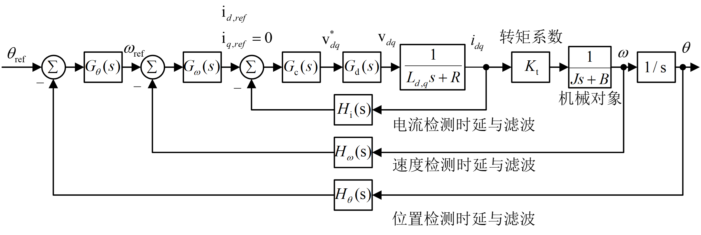
</p>

- 电流环 — `10 kHz`，对象为等效 R/L 串联，默认 `250 Hz`
- 速度环 — 名义 `2 kHz`，对象为 `Kt/J` 积分，默认 `10 Hz`
- 位置环 — `200 Hz`，对象近似纯积分，默认 `2 Hz`

电流环带宽受 PWM 更新率限制：当前更新率为 `5 kHz`，`500 Hz` 时相位裕度约 `45°`，接近 `800 Hz` 时只剩约 `18°`，会出现振铃并可能触发过流保护。需要更高带宽时应先在 CubeMX 中减小 `TIM1` 的 `RCR` 以提高更新率。

速度反馈链的等效延迟约 `1.6 ms`，由 SPI 样本龄、5 点测速窗群延迟、`150 Hz` 测速低通和 `2 kHz` 零阶保持组成，对应速度环带宽上限约 `40 Hz`，默认 `10 Hz` 留了约 4 倍余量。`CFG_MOTOR_INERTIA_KGM2` 为估计值，是速度环增益的实际旋钮：振荡时减小，响应过软时增大。

`g_cmd.iq_lim_a` 同时限制电流给定和速度环输出，默认 `16 A`，与过流阈值 `CFG_PROT_PHASE_OC_A` 相同，满限幅运行需留意超调。

### 6.5 保护、状态机与遥测

快环每拍检查 `N_FAULT` 电平、三相电流幅值和编码器有效性；母线过压（`> 65 V`）、欠压（`< 12 V`）在 `1 kHz` 慢任务中锁存。任一故障位置位后进入 FAULT 状态并关闭功率级，故障源消失后写 `g_cmd.clear_fault = 1` 回到 IDLE。欠压仅在非待机状态下锁存，避免只上逻辑电时卡在故障态。

后台 `program_task()` 只负责遥测输出，不接触控制量。

---

<a id="sec-7"></a>

## 7. 测试

### 7.1 测试项目

- 电源输入范围 — 标准 `48 V ±15%`，40~56 V 范围内正常运行
- 启停性能 — 标准为空载启动平稳无振动，见验收视频
- 速度控制精度 — 目标 100 / 200 rpm，输出轴 100 rpm 下扰动约 3 rpm，200 rpm 下约 8 rpm
- 位置控制精度 — 目标 90° / 180°，阶跃响应基本无静差
- 负载输出能力 — 10 cm 力臂带载 2 kg，相电流 ≥ 6 A；分别按 60 W 与 180 W 等级完成测试
- 持续带载温升 — 10 cm 力臂、2 kg 负载、48 V 母线、265 rpm 连续运行，热像见 7.4

验收视频见 [STM32-MPS-FOC电机全流程测试](https://www.bilibili.com/video/BV1HWXkBHEVS/)，流体负载补充测试见 [30mins 流体负载测试](https://www.bilibili.com/video/BV1bgvYBtEYp/)。

### 7.2 测试平台

双电机对拖平台左侧为驱动电机，右侧为发电机，整流后接入电子负载或实验台架。

| 对拖平台                    | 测量设备                   |
| ----------------------- | ---------------------- |
| 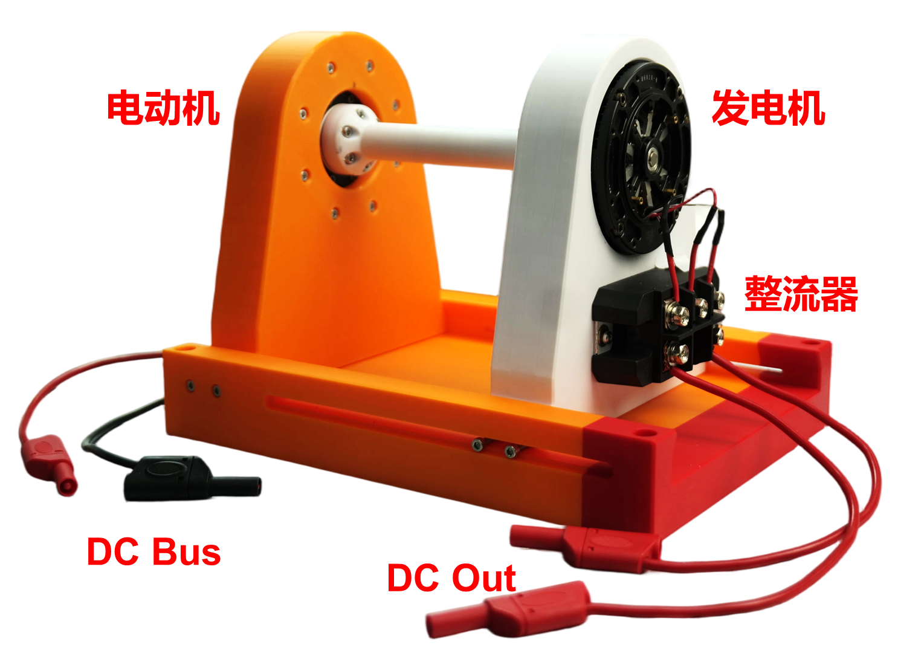 | 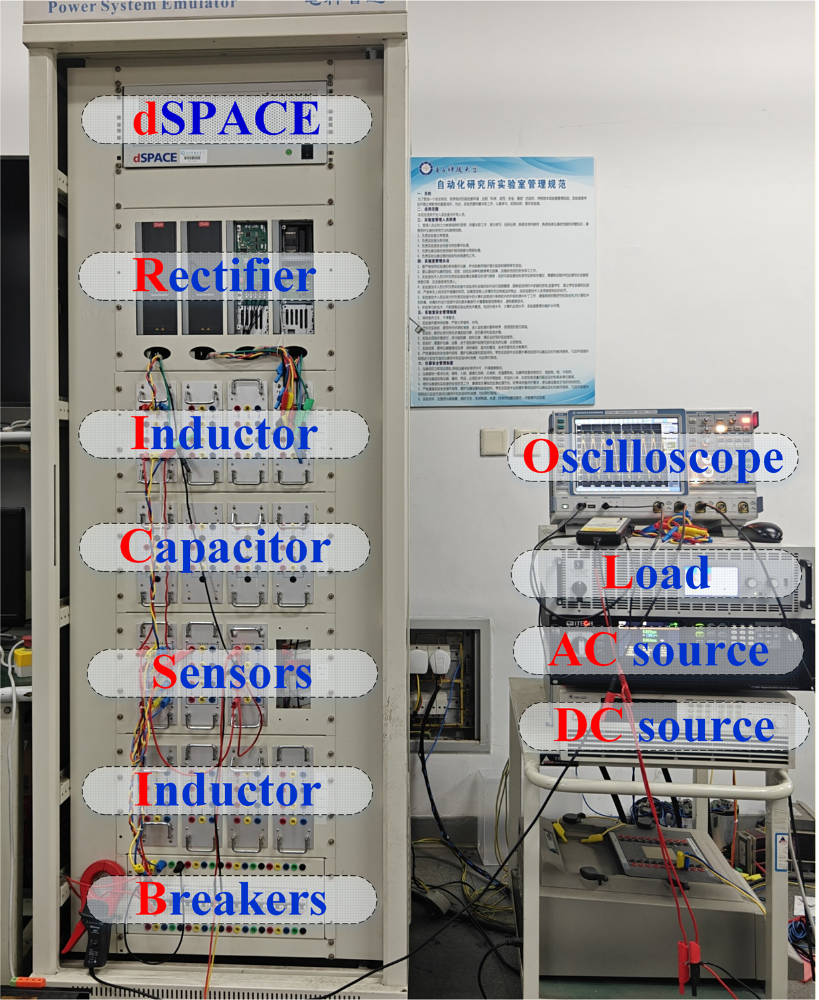 |

### 7.3 速度环与位置环响应

| 速度环跟踪                                                    | 速度环阶跃                                                    |
| -------------------------------------------------------- | -------------------------------------------------------- |
| 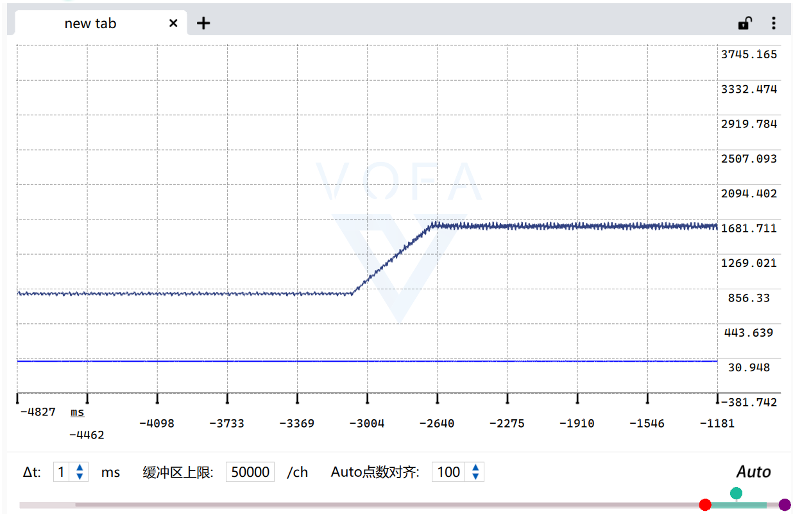 | 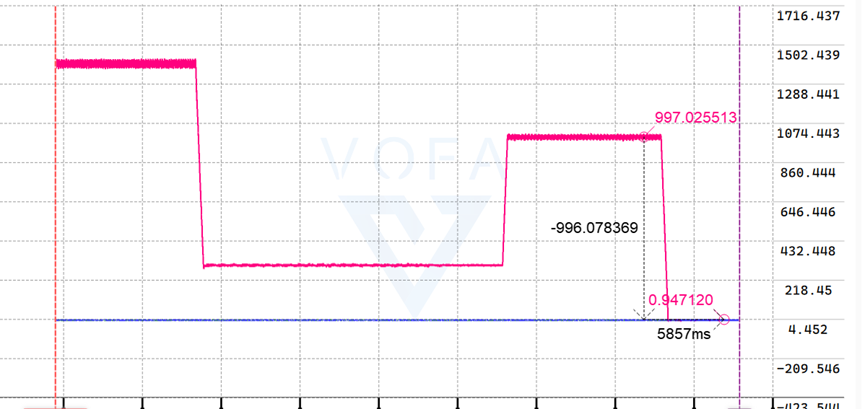 |

<p align="center">
  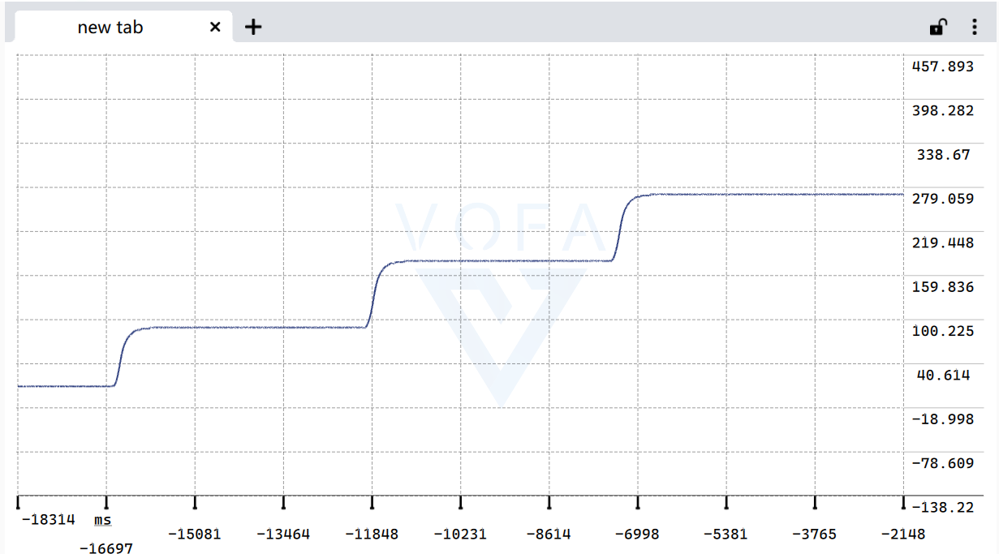
</p>

图中转速为减速箱输出轴之前的机械转速。

### 7.4 带载温升

<p align="center">
  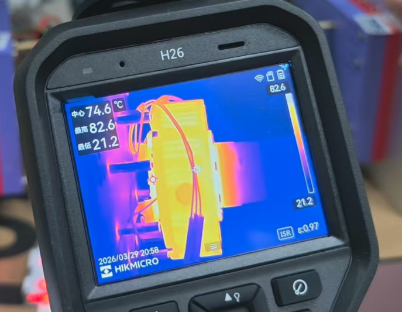
</p>

带载 8 min 后壳温约 `74.6 °C`，最高热点约 `82.6 °C`；带载 2 min 时中心温度约 `35.4 °C`、最高约 `61.8 °C`。

---

<a id="sec-8"></a>

## 8. 上电调试

整定全程用串口上位机完成，本节只讲操作步骤，判据与异常定位见 [`docs/quick-start.md`](docs/quick-start.md)。

### 8.1 连接与界面

1. 调试器接控制板调试口，同时把 USB 串口接到板载 `USART1`。
2. Keil 编译并烧录固件。
3. 关掉 VOFA 等占用串口的程序，打开上位机，选对应串口，点「连接控制板」。

<p align="center">
  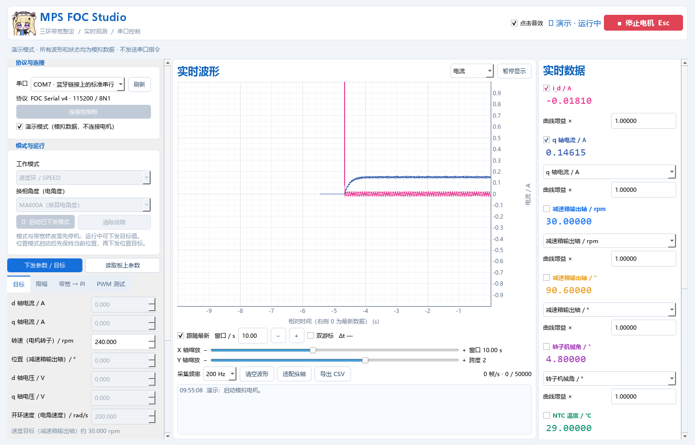
</p>

左上「协议与连接」选串口、连控制板，左下「模式与运行」设模式与目标，中间实时波形，右侧实时数据。

改完参数点「下发参数」，回读正确后再点「启动已下发模式」，电机运行。

参数写 RAM，复位恢复 `app_config.h` 编译默认值；STOP 只清 `run`，模式与参数保留；远程启动后 `2 s` 无有效指令，固件自行撤销运行。

### 8.2 上电自检与采样

上电后固件自动完成 `ADC1`/`ADC2` 校准、`TIM1` 以 50% 占空比起振、累计三相电流零偏、启动 `ADC2 + DMA` 采样母线电压与 NTC、读取一次 MA600A 角度。

每次进入控制模式都会自动重做一次电流零偏，母线电压与 NTC 采样同理。MA600A 单独验证：面朝电机出轴端，逆时针转一周，机械角度应正增长。

### 8.3 发波与开环验证

先断开电机验证功率级：模式选 `PWM TEST`，三相给不一致的占空比（如 `0.30` / `0.40` / `0.60`），示波器依次看 MCU 六路输出、`MP6539B` 栅极、相线开关波形，确认互补正常、无直通。

<p align="center">
  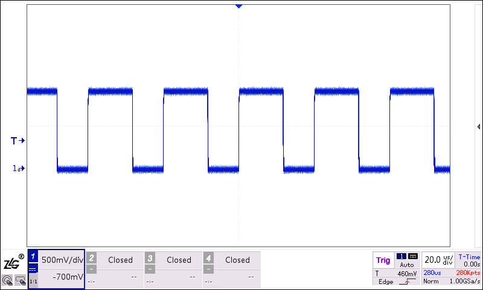
</p>

单路相线开关波形，`500 mV/div`、`20 us/div`。六路两两互补、中间留死区；三相占空比不同，示波器上才能分清是哪一相。

再确正方向：模式选 `VOLTAGE`，换相角度先选开环积分电角度，给定 q 轴电压，确认能转起来、且面朝出轴端为逆时针；方向反了就任意对调两根相线。然后把换相角度切成 MA600A 换算的电角度重复一次，此时启动前会先执行 §6.3 的零位对齐。

### 8.4 三环调试顺序

由内到外依次闭合，每一步确认稳定后再进入下一步：

- 电流环 — `CURRENT` 模式，`id` 给 `0`、`iq` 给 `0.1~0.3 A`、限幅 `1 A`；手握手摇曲柄做堵转，看跟踪效果与出力大小
- 速度环 — 拆掉曲柄，`SPEED` 模式给 `20 rpm` 左右的转速阶跃，看响应速度、超调与稳态误差
- 位置环 — `POSITION` 模式给目标角度，看跟踪精度；可装回曲柄用力拖动，做对抗测试

带载与温升测试见 §7.4；保护阈值在「限幅」页设置，且只能在待机状态修改。

---

<a id="sec-9"></a>

## 9. 新电机适配

换电机本质上只是把这几个量填对：*R*、*L*、*K*<sub>t</sub>、减速比 *i*、极对数 *p*、编码器方向与相序。它们全部集中在 [`program/App/app_config.h`](program/App/app_config.h)，改完重新编译烧录，其余代码不用动。

| 符号 | 含义 | 对应宏 |
| --- | --- | --- |
| *p* | 极对数 | `CFG_MOTOR_POLE_PAIRS` |
| *i* | 减速比，无减速器填 `1` | `CFG_MOTOR_GEAR_RATIO` |
| *R* | 相电阻 | `CFG_CUR_EQ_R_OHM` |
| *L* | 相电感 | `CFG_CUR_EQ_L_H` |
| *K*<sub>t</sub> | 扭矩常数，转子侧 | `CFG_MOTOR_KT_NM_A` |
| 编码器方向 | 正转时读数增还是减 | `CFG_ENC_DIR_SIGN` |
| 相序 | `U/V/W` 与三相线的对应 | `CFG_CUR_SIGN_IA` / `IB` / `IC` |

其中 *p*、*i* 与编码器方向填错，闭环会从负反馈变成正反馈，表现为对齐失败、抖动、发热；

电流环带宽从 `100~200 Hz` 起步，`iq_lim_a` 先压到理论安全值的 `20%~30%`，稳定后再逐步放宽；母线电压范围用来在「限幅」页设过压/欠压阈值。完整辨识流程、限流估算与验收判据见 [`docs/适配新电机标准流程.docx`](docs/适配新电机标准流程.docx)。

---

<a id="sec-10"></a>

## 10. 已知限制

### 10.1 高速运行噪声

开环 `VOLTAGE` 模式在相同转速下噪声更大，速度环增益减半对噪声无明显影响，说明噪声不由控制环路放大，来源在电机本体、换相角误差或减速箱。
首要嫌疑是 MA600A 未做 INL 校准导致的换相角误差，其次是**行星减速箱的固有机械噪声**。
MA600A 手册指标为校准前 `< 0.6°`、片上 32 点校准后 `< 0.1°`，当前反馈链路尚未做 INL 校准。
MPS 官方提供了无参考编码器的恒速旋转校准方法，详见 [AN245：MA600A 校准应用笔记](https://www.monolithicpower.cn/cn/an245-calibration-of-the-ma600a?utm_source=chatgpt.com)。

### 10.2 位置环静摩擦抖动

位置环在目标角度附近会出现小范围低频抖动，来源是减速箱静摩擦力与速度环积分的共同作用，固件用保持/爬行逻辑抑制。上位机「带宽 → PI」页可勾选旁路这套逻辑做对照；阈值在 [`program/App/app_config.h`](program/App/app_config.h) 的 `CFG_POS_HOLD_*` 与 `CFG_POS_CREEP_*` 里改，重新编译烧录后生效，上位机不下发这两组参数。

速度环若剧烈抖动，优先检查控制板与电机的安装距离和接地：控制板尽量贴近电机，避免板背 VIN 开窗部分与电机导电件接触。

---

<a id="sec-11"></a>

## 11. 许可证说明

本项目基于 **GNU General Public License v3.0** 发布，详细条款见 [`LICENSE`](LICENSE)。衍生作品需同样以 GPL 3.0 发布并保留源码。

```text
MPS-FOC STM32G431
Copyright (C) 2026 MPS China University Program
This program is free software: you can redistribute it and/or modify
it under the terms of the GNU General Public License as published by
the Free Software Foundation, either version 3 of the License.
```
